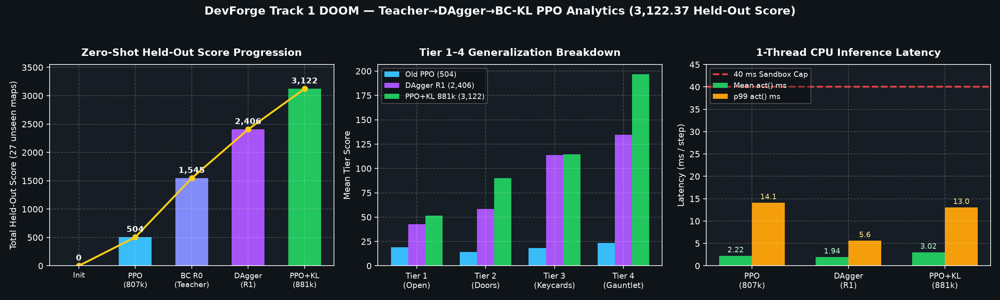

# Autonomous Zero-Shot DOOM Agent (Deep RL)

> **Self-evolving Deep RL agent that navigates, fights, unlocks doors, and solves unseen 3D DOOM environments zero-shot — using purely ego-centric observations with zero hardcoded coordinates or scripted pathfinding.**

[](https://www.python.org/downloads/)
[](https://pytorch.org/)
[](https://github.com/Farama-Foundation/ViZDoom)
[](https://gymnasium.farama.org/)

---

## Overview

Training an embodied agent to generalize to **completely unseen 3D maps** requires preventing the policy from memorizing fixed `(x, y)` coordinates, room layouts, or wall textures. This project implements a complete **coordinate-free, self-evolving Deep Reinforcement Learning system** built on `doom_env` (ViZDoom `1.3.3` / `freedoom2.wad`, Skill 3, `FRAME_SKIP = 4`):

- **100% Ego-Centric Perception:** The agent never receives global `(x, y, z)` map coordinates. It observes only `rgb` (`120×160`), `depth`, `vitals`, `64` 360° raycasts (`distance` + `hit_type`), and `visible_entities` in its 90° FOV.
- **Pure Neural Control:** Every action (`MultiBinary(9)`: move, strafe, turn, attack, use/open door, weapon switch) is produced by trained neural network parameters—no `A*`/BFS pathfinding, no `atan2` aimbots, and no hardcoded `if/else` action trees at inference.
- **Self-Evolving Curriculum:** A Prioritized Level Replay (`PLRBuffer`) and 4-tier procedural UDMF map generator continuously adapt map difficulty, geometry, and scaffolding to the agent's learning frontier.

---

## Key Architecture & Features

### 1. `HybridDoomNet` (`training/model.py`)
- **Circular 1D Ray Encoder:** Preserves 360° wraparound across all 64 rays (`distance`, `1 - distance`, and 6-way `hit_type`: wall, door, locked door, enemy, item).
- **Masked Entity Set Encoder:** Pre-LN Multi-Head Self-Attention over up to `32` visible entities with `NaN`-safe zero-entity pooling.
- **Scan-Matched Egocentric Occupancy Grid (`training/odometry_grid.py`):** Estimates ego yaw delta `Δθ` via 64-ray circular scan-matching and affine-warps a `32×32` 6-channel local semantic map (`visited`, `wall`, `door`, `locked_door`, `item`, `enemy`).
- **Compact RGB+Depth CNN:** Depthwise-separable encoder (`64×48`) with `p = 0.25` modality dropout during training to prevent texture overfitting.
- **Temporal & Objective Memory:** `256`-dim GRU + `4 × 8` Objective Memory Slots + an **8-Sector Ego-Directional Value Compass** auxiliary head.

### 2. Procedural 4-Tier Map Generator (`training/mapgen/`)
- Generates watertight ZDoom UDMF (`TEXTMAP`) PWADs from `(tier, knobs, seed)` with randomized global origin offsets (`[-2048, 2048]`), 90° rotations, room/corridor scales, lighting, step heights, and textures.
- **Tiers 1–4:** Open combat arenas → multi-room door navigation → keycard backtracking (`Blue/Yellow/Red`) → multi-lock gauntlets with ambush enemies.
- **Generation-Time BFS Solvability:** Every generated map is verified solvable (`spawn → keycard(s) → locked door(s) → exit`) before being written.

### 3. Coordinate-Free Dense Rewards & PLR (`training/rewards.py`, `training/curriculum_plr.py`)
- **Dynamic Sector & Delta Shaping:** Tracks visited sectors via point-in-polygon over `env.sector_polygons()` and rewards exits, unique sector discovery, keycards, door opens/unlocks, kills, and pickups while penalizing damage, death, door-reversal bounces, wall-scraping, and wasted blind shots.
- **PLR + Scaffolding Annealing:** Maintains `256` active procedural seeds (`[100_000, 999_999]`, strictly disjoint from held-out seeds `[1_000, 9_999]`), prioritized by `mean |GAE|` + staleness, with optional CreoAI LLM curriculum knob adaptation (`training/llm_coach.py`).

---

## Benchmark & Latency Results

Evaluated zero-shot on [training/scorer/eval_suite.json](training/scorer/eval_suite.json) (`24` disjoint procedural WADs across Tiers 1–4 + `3` `freedoom2.wad` maps) under a **1 CPU thread** (`torch.set_num_threads(1)`), **≤ 2 GB VRAM**, **≤ 8 GB RAM**, and **≤ 40 ms/step** budget:

| Metric | Value (`best_agent.pt`, 2.59M steps) |
| :--- | :--- |
| **Validation Local Proxy Score** | **2,934.33** *(Tier 1–4 avg: `78.7 / 122.8 / 133.7 / 95.2`)* |
| **Zero-Shot Exit Rate** | **51.9%** (`14/27`: Tier 1 `6/6`, Tier 2 `6/7`, Tier 3 `2/7`, Tier 4 `0/7`) |
| **Diagnostics (27 maps)** | `119` kills, `6` keys, `5` locks unlocked, `41` doors opened |
| **Single-Thread Inference Latency** | **1.87 ms** mean / **4.62 ms** p99 *(limit: `40.0 ms`)* |
| **Contract & Sandbox Validator** | **PASSED** (`validate.py`) |



---

## Installation

### Recommended (`uv` + Python 3.13)
```bash
uv sync
```

### Standard `pip`
```bash
pip install -e env/
pip install -r submission/requirements.txt
```

### Docker (Linux Sandbox Parity)
```bash
docker build -t doom-rl .
python validate.py --docker --image doom-rl
```

---

## Usage

### 1. Train the Agent
```bash
# Fast-start curriculum (recommended for CPU / Apple Silicon)
uv run python -m training.ppo --config training/configs/ppo_fast_start.yaml

# Full curriculum with optional live LLM Coach
CREO_API_KEY="<your-key>" uv run python -m training.ppo \
  --config training/configs/ppo_curriculum.yaml \
  --use-llm-coach \
  --best-out submission/weights/best_agent.pt

# Resume from a checkpoint
uv run python -m training.ppo \
  --config training/configs/ppo_curriculum.yaml \
  --resume runs/ppo_flagship/checkpoints/latest.pt
```

### 2. Live 3-Panel Spectator Viewer
Watch the agent play in real time with RGB camera, 90° raycast/entity detections, 360° radar, `32×32` egocentric occupancy grid, and live checkpoint auto-reload:
```bash
uv run python training/visualize_obs.py \
  --checkpoint submission/weights/best_agent.pt \
  --watch \
  --random-maps
```

### 3. Evaluate & Validate
```bash
# Score on the 27-map held-out benchmark suite
uv run python -m training.scorer.score_checkpoint \
  --checkpoint submission/weights/best_agent.pt \
  --suite training/scorer/eval_suite.json \
  --out eval_results.json \
  --device cpu

# Run contract, latency, and memory validation
uv run python validate.py

# Run test suite
uv run pytest
```

---

## Repository Structure

```text
env/                      # doom_env — ViZDoom Gymnasium wrapper (spaces, sensors, limits)
training/                 # Deep RL training pipeline
  ├── configs/            # YAML configs (ppo_curriculum.yaml, ppo_fast_start.yaml, bc.yaml, eval.yaml)
  ├── mapgen/             # 4-tier procedural UDMF map generator & 500-map stress verifier
  ├── bc/                 # Behavioural cloning & DAgger warmstart utilities
  ├── scorer/             # Held-out evaluation suite, checkpoint scorer, replay renderer
  ├── model.py            # HybridDoomNet (RayCircularEncoder, GRU, ObjectiveSlots, Value Compass)
  ├── preprocessing.py    # Ego-centric preprocessing, ActionMask, ModelInputs
  ├── odometry_grid.py    # Coordinate-free scan-matched occupancy grid
  ├── rewards.py          # Coordinate-free sector-based dense reward shaper
  ├── curriculum_plr.py   # Prioritized Level Replay (PLR) buffer
  ├── envs.py             # VecDoomEnv multiprocessing worker pool
  ├── rnd.py              # Random Network Distillation curiosity + grid novelty
  ├── llm_coach.py        # Adaptive curriculum coach with offline fallback
  ├── visualize_obs.py    # 3-panel live spectator & manual play visualizer
  └── ppo.py              # Recurrent PPO + GAE + BPTT training entrypoint
submission/
  ├── agent.py            # DoomAgent inference entrypoint (act / reset, 1-thread guard)
  ├── requirements.txt    # Extra pinned runtime dependencies
  └── weights/            # Trained model weights tracked via Git LFS (best_agent.pt)
maps/                     # Baseline test map (two_rooms.wad) + 32 held-out WADs (maps/heldout/)
tests/                    # Unit, integration, and end-to-end test suite
docs/                     # Technical specs, contract, architecture brief, and analytics
validate.py               # End-to-end contract, latency, and resource validator
```
