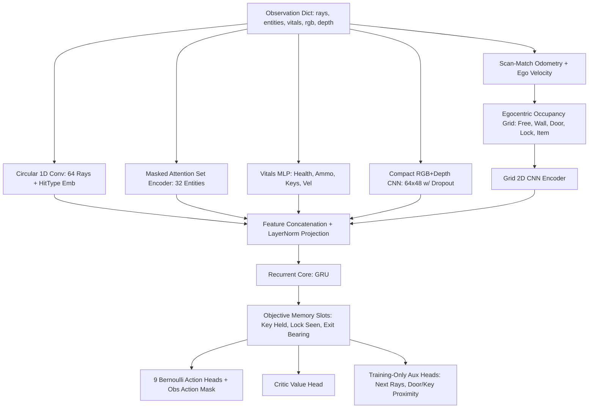
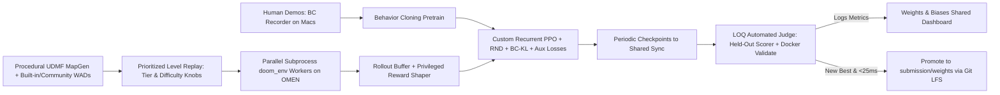

# Yugaantar 2026 · DevForge — Track 1: "Can It Play DOOM?" Game Plan

> **Rule Reminder:** Per `docs/RULES.md`, the repository, model architecture, and training code **must be created during the hackathon**. Before the clock starts, complete **only** environment setup, reading, and control practice (Section 8). Write **zero** project code before start time.

---

## 1. TL;DR & Win Thesis

* **Target Track:** Track 1 (*"Can It Play DOOM?"*), avoiding friend-group overlap on Track 4 and capitalizing on CPU-fast spatial simulation + custom RL architecture.
* **Win Thesis — Partial Progress Wins Stage 1:** The automated leaderboard awards weighted partial progress across 4 unseen tiers (Exit > Progression [keys, doors, locks] > Exploration [unique sectors] > Combat [kills minus damage/early death]). Most teams wrap default pixel PPO (or SB3) and spin in corners; a reliable spatial-memory navigator + fighter clears Tiers 1–2 and unlocks Tier 3 progression points.
* **Win Thesis — Generalization via Procedural UDMF Maps:** Hidden maps are unseen, short-horizon (2,100–4,200 ticks = 60–120 s), and tiered. Training primarily on our own randomized 4-tier procedural UDMF map generator prevents memorization and turns "infinite unseen layouts" into our core strength.
* **Win Thesis — Human-Demo Warm-Start + Custom Architecture:** 1–2 hours of team gameplay recorded through `doom_env` teaches door timing (`USE` edge), strafe-shooting, and key pickups instantly via Behavior Cloning (BC), then custom recurrent PPO + RND + Egocentric Occupancy Grid + Objective Slots refines combat and long-horizon backtracking.
* **Win Thesis — Built for Manual & Replay Review:** The top 4–5 teams have their code and replays manually reviewed, and the top 2 advance to finals. Clean custom PyTorch code, scan-matching egocentric grid memory, held-out local evaluation, and crisp replay demos directly maximize both automated and human scores.

---

## 2. Verified Template & Contract Facts

Verified directly against the official starter template (`Reinforce-SST/devforge-doom-template`: `docs/CONTRACT.md`, `docs/EVALUATION.md`, `docs/RULES.md`, `docs/SUBMISSION.md`, `env/doom_env/spaces.py`, `env/doom_env/limits.py`, `env/doom_env/wrapper.py`).

| Component | Verified Specification | Design Implication |
| :--- | :--- | :--- |
| **Observation: `rgb` & `depth`** | `rgb`: `(120, 160, 3)` `uint8`; `depth`: `(120, 160)` `uint8` (HUD/crosshair/messages disabled) | Downsample `rgb` to `64×48` (and optional depth strip) for a tiny CNN; apply modality dropout so spatial branch carries load if pixels shift. |
| **Observation: `vitals`** | `(17,)` `float32`: `health`, `armor`, `selected_weapon`, `selected_weapon_ammo`, `ammo_bullets/shells/rockets/cells` (0–7), 6 binary key flags (`key_blue/yellow/red_card` & `skull`, 8–13), ego velocities `vel_forward`, `vel_right`, `vel_up` (14–16) | Keys are observed directly once picked up. **No global position or yaw heading/angle is provided.** |
| **Observation: `rays`** | `64` rays over full **360°** (idx `0` straight ahead, CCW, idx `16` = 90° left, idx `32` = behind), `RAY_RANGE = 1024.0`, `distance` normalized `[0, 1]`, `hit_type` in `{0: none, 1: wall, 2: door, 3: locked_door, 4: enemy, 5: item}` | Agent sees 360° around itself without pixels! Consecutive 360° ray scans allow **circular cross-correlation scan-matching** to estimate turn angle `Δθ` for dead-reckoned mapping. |
| **Observation: `visible_entities`** | Up to `MAX_ENTITIES = 32` inside **90° horizontal FOV** & line-of-sight (≤ 4,096 units); `features` `(32, 5)`: `[dist/1024, sin(rel_angle), cos(rel_angle), rel_vel_fwd, rel_vel_right]`; `entity_type` (12 IDs incl. `pad`, `enemy_melee`, `enemy_hitscan`, `enemy_projectile`, `projectile`, `health`, `armor`, `ammo`, `weapon`, `key`, `barrel`, `other`); `mask` `(32,)` | Permutation-invariant set encoder (masked attention / DeepSets) handles arbitrary enemy/item counts without fixed-slot truncation bugs. |
| **Action Space** | `MultiBinary(9)`: `0: MOVE_FORWARD`, `1: MOVE_BACKWARD`, `2: MOVE_LEFT`, `3: MOVE_RIGHT`, `4: TURN_LEFT`, `5: TURN_RIGHT`, `6: ATTACK`, `7: USE`, `8: SELECT_NEXT_WEAPON` | `USE` and `SELECT_NEXT_WEAPON` trigger **only on button-down edge**; pressing `USE` on a moving door **reverses** it. Must prevent `USE` spam via learned cooldown / edge masking. |
| **Timing & Engine** | `FRAME_SKIP = 4` ticks/decision; episode cap `2100–4200` ticks (~525–1,050 decisions); `freedoom2.wad` IWAD, `SKILL = 3`, `vizdoom==1.3.3`, Python `3.13` | Train strictly at `FRAME_SKIP = 4` on `doom_env` observations (`render_buffers=True` for hybrid RGB, `False` option for fast spatial ablations). |
| **Training Helpers (`wrapper.py`)** | `make_env(wad, map_name, episode_ticks)`; `env.privileged_state()` exposes `x, y, z, angle, kills, items, damage_taken, keys, door_lock, sector_floor/ceil`; `env.sector_polygons()` gives map geometry | Use `privileged_state()` & `sector_polygons()` freely in **training** for dense sector-exploration rewards, door-open events, and auxiliary supervision targets. Never available at eval. |
| **Eval Limits Conflict** | `EVALUATION.md` / `limits.py` list **6 GB VRAM (`MAX_VRAM_MB=6144`), 16 GB RAM, 4 CPU cores** *(draft)*; track brief says **2 GB VRAM, 8 GB RAM, 1 CPU thread**. | **Design strictly for the tighter envelope:** `torch.set_num_threads(1)`, ≤ 1.5 GB VRAM, **≤ 40 ms** avg `act()` (`AGENT_MS_PER_STEP = 40.0`). Init ≤ 60 s, reset ≤ 10 s, 1st `act()` ≤ 10 s, other `act()` ≤ 5 s. Crash/timeout/invalid action freezes agent for rest of map. |
| **Ground Rules** | **Banned:** hand-written `if/else` action trees, `A*`/Dijkstra/BFS planners, `atan2` aimbots, unmodified off-the-shelf SB3. **Allowed:** preprocessing, action masking from obs, frame stacking, learned memory, any training-time scaffolding (auto-doors, ACS, extra ammo). | Scan-matched occupancy grid + ray-based `USE` cooldown mask are legal observation preprocessing / action masking — all action decisions come from trained PyTorch weights. |
| **Submission & Review** | Public GitHub repo from template, `submission/agent.py` (`DoomAgent`), weights in `submission/weights/` via Git LFS, total repo **≤ 1 GB**, `training/` kept intact, `submission/requirements.txt` pinned (≤ 50 pkgs), `python validate.py --docker` passing. Top 4–5 teams manually audited; Top 2 to Finals + 2-page PDF Brief. | Keep repo lean (only final promoted weights tracked cleanly with LFS), document everything cleanly, and pass `validate.py --docker` before every milestone merge. |

---

## 3. Locked Decisions

| # | Area | Locked Choice |
| :--- | :--- | :--- |
| **1** | **Track** | **Track 1: "Can It Play DOOM?"** (keeps us independent of friends on Track 4; plays to fast CPU sim + custom PyTorch RL). |
| **2** | **Compute Split** | **100% Local:** **OMEN** (i9 HX, RTX 5060 8 GB) = primary high-worker RL trainer; **LOQ** (i5-13, RTX 4050) = automated held-out checkpoint judge + parallel ablations; **MacBook M5 & M3** = mapgen, demo recording, reward/scorer dev, brief/docs. Azure available only as emergency backup. |
| **3** | **Runtime & Parity** | **WSL2 Ubuntu 24.04 + `uv` + Python 3.13** on OMEN & LOQ for fast, stable Linux multiprocessing; **Docker Desktop** running the official template `Dockerfile` on all machines for `validate.py --docker` parity; native arm64 ViZDoom on Macs for local dev/demo recording. |
| **4** | **Team Sync & Git** | Public GitHub repo initialized from `Reinforce-SST/devforge-doom-template` at H0; protected `main` with feature branches + PRs gated by `pytest` & `validate.py`; **Tailscale** so Macs SSH into OMEN/LOQ; **W&B** shared dashboard; shared checkpoint folder; final weights via **Git LFS**; zero secrets committed. |
| **5** | **Observation Stack** | **Hybrid from the start:** 64-ray circular 1D CNN (+ learned hit-type embeddings) + masked entity set encoder (attention/DeepSets over ≤32 entities + type embeddings) + vitals MLP + compact RGB CNN (`64×48` downsampled RGB + optional depth strip) with **RGB modality dropout** during training. |
| **6** | **Memory Architecture** | **Most ambitious (with clean fallback):** Egocentric local **Occupancy Grid** built from 360° rays + scan-matched odometry (`vel_forward/right` translation + circular cross-correlation on consecutive ray scans & turn history for `Δθ`), tracking free/wall/door/locked-door/item/key-seen channels → CNN → fused with **GRU** core + **Objective Memory Slots** (keycard held, locked-door seen, exit seen with dead-reckoned bearing), trained with auxiliary losses. *Fallback:* GRU + Objective Slots only. |
| **7** | **RL Algorithm** | **Custom Recurrent PPO** written from scratch in PyTorch: GAE, clipped surrogate, truncated BPTT chunks, 9 independent Bernoulli heads + observation-derived action masking, **RND curiosity** + grid-novelty exploration bonus + auxiliary prediction losses. Parallel `make_env` subprocess workers feeding batched GPU forward/backward passes. |
| **8** | **Training Maps** | **Four-source mix:** (1) **Custom Procedural UDMF Generator** producing randomized 4-tier maps every episode (arenas → multi-room door graphs → keycard/locked-door/backtracking puzzles → gauntlets, scaled to 2,100–4,200 ticks) as primary engine; (2) ViZDoom built-in scenarios; (3) template `maps/two_rooms.wad` + `tests/fixtures/*.wad`; (4) Freedoom 2 / curated community maps. Strict train/held-out split. |
| **9** | **Policy & Curriculum** | **5-stage pipeline:** (1) Human-demo Behavior Cloning (BC) warm-start (1–2 h team gameplay via `doom_env` recorder) → (2) Recurrent PPO initialized from BC with decaying **BC-KL penalty** → (3) **Prioritized Level Replay (PLR)** over procedural generator difficulty knobs → (4) **Annealed training scaffolding** (auto-opening doors, generous ammo/health → gradually removed) → (5) **Final vanilla-only fine-tune** strictly matching eval rules. |
| **10** | **Reward Shaping** | Training-only dense rewards via `privileged_state()` & `sector_polygons()`: large exit bonus, new unique sector coverage, keycard pickup, door opened, locked door unlocked, enemy kills, damage dealt, minus damage taken, death penalty, small per-step time cost, and stuck/spin/USE-spam penalties. |
| **11** | **Checkpoint Selection** | Dedicated **Local Scorer** on LOQ mirroring `EVALUATION.md` (Exit+Efficiency, Progression, Sector Exploration, Combat, tier-weighted) across a **fixed held-out benchmark suite** (never seen in training). Every saved checkpoint is auto-scored, logged to W&B, and promoted to `submission/weights/` **only** if it beats current best AND passes `validate.py --docker` with latency margin (`< 25 ms/step` target). |
| **12** | **Team Ownership** | **A (OMEN):** RL core (PPO, subprocess envs, RND, main training runs). **B (LOQ):** Neural model, `odometry_grid.py`, `submission/agent.py`, latency/validator, local scorer & checkpoint judge. **C (M5):** Procedural UDMF generator, PLR curriculum, reward shaping. **D (M3, joins +4h):** Human demo recorder + 1–2 h gameplay demos, then 2-page Brief PDF, README, architecture diagram, replay/demo video, desk-review Q&A prep. Everyone writes `pytest` tests for their own modules. |

---

## 4. System Architecture

### 4.1 Agent Inference & Neural Architecture (`DoomAgent`)



**Key Architectural Details:**
* **360° Scan-Matching Odometry (`odometry_grid.py`):** Because `vitals` provides ego `vel_forward` and `vel_right` but no yaw heading `Δθ`, we estimate per-step yaw rotation by finding the circular shift `k ∈ [-8, +8]` across the 64-ray scan (`5.625°/bin`, refined parabolically) that minimizes `L1` range+hit-type discrepancy against the previous scan translated by `vel * dt`, conditioned on `TURN_LEFT`/`TURN_RIGHT` history. On each `act()`, we warp the `32×32` local egocentric grid (`~48 map units/cell`, ~1,536×1,536 coverage) via `grid_sample`/affine shift and splat current ray endpoints into semantic channels (`visited`, `wall`, `door`, `locked_door`, `item`, `enemy_recent`).
* **Objective Memory Slots:** Explicit learned memory slots updated alongside the GRU hidden state and supervised during training via `privileged_state()`: whether a keycard is held (from `vitals[8:14]`), whether a locked door or exit was spotted, and their dead-reckoned egocentric `(sin, cos, inv_dist)` coordinates warped step-by-step by odometry.
* **Action Masking (Rule-Compliant):** Allowed by `docs/RULES.md §1`: (a) `USE` cooldown mask suppressing consecutive `USE=1` outputs immediately after pressing `USE` near a door (prevents door-reversal bounce); (b) `ATTACK` suppressed only when `selected_weapon_ammo == 0` on non-melee weapons; (c) `MOVE_FORWARD`/`MOVE_BACKWARD` conflict resolution via softmax/Bernoulli probabilities without deterministic if/else navigation trees.
* **Latency Budget Guard:** Targeting `≤ 20 ms/step` on 1 CPU thread (half the `40 ms` cap) with `torch.set_num_threads(1)` and optional `TorchScript`/`torch.compile` export verified inside Docker.

### 4.2 End-to-End Training, Curriculum & Promotion Loop



---

## 5. Module Interfaces & Planned Repository Layout

```text
<team-doom-repo>/                  # Created from Reinforce-SST/devforge-doom-template at H0
├── env/                           # Official wrapper (DO NOT MODIFY for submission parity)
├── maps/                          # two_rooms.wad + non-eval practice WADs
├── submission/
│   ├── agent.py                   # DoomAgent (__init__, reset, act) — self-contained inference
│   ├── requirements.txt           # Minimal pinned extras if any (prefer base image packages only)
│   └── weights/                   # Promoted final checkpoint(s) tracked via Git LFS
├── training/
│   ├── README.md                  # Full training & ablation instructions for judges
│   ├── configs/                   # YAML/dataclass configs (bc.yaml, ppo_curriculum.yaml, eval.yaml)
│   ├── preprocessing.py           # preprocess(obs, odom_state) shared identically by train & agent.py
│   ├── odometry_grid.py           # 360° scan-matching odometry + egocentric occupancy grid builder
│   ├── model.py                   # Hybrid encoders, Grid CNN, GRU, Objective Slots, heads
│   ├── envs.py                    # Subprocess vectorized doom_env workers + scaffolding hooks
│   ├── rewards.py                 # Privileged-state dense reward shaper (exit, sectors, progression, combat)
│   ├── rnd.py                     # Random Network Distillation + grid novelty intrinsic rewards
│   ├── ppo.py                     # Custom recurrent PPO (GAE, BPTT chunks, BC-KL, aux losses)
│   ├── curriculum_plr.py          # PLR buffer over procedural generator parameters & WAD pool
│   ├── bc/
│   │   ├── record_demos.py        # Interactive keyboard recorder using doom_env step loop
│   │   └── train_bc.py            # Behavior cloning warm-start trainer
│   ├── mapgen/
│   │   ├── udmf_builder.py        # UDMF TEXTMAP writer + node builder (bsp/zdbsp) wrapper
│   │   └── tiers.py               # Tier 1-4 parameterized procedural map generators
│   └── scorer/
│       ├── eval_suite.py          # Held-out map manifest (locked seeds, never touched in training)
│       └── score_checkpoint.py    # EVALUATION.md mirror (weighted tier score + latency + Docker check)
├── tests/                         # Existing wrapper tests + unit/integration tests for every module
└── validate.py                    # Official validator
```

### Module Contracts (Freeze at H0.5 so all 4 streams work in parallel)

1. **Preprocessing Contract (`training/preprocessing.py` & mirrored/imported in `submission/agent.py`):**
   * `preprocess(obs: dict, state: OdomGridState) -> tuple[ModelInputs, OdomGridState]`
   * Consumes exact `doom_env` dict (`rays`, `visible_entities`, `vitals`, `rgb`, `depth`), normalizes scales, updates egocentric occupancy grid + `USE`-edge cooldown state, returns batched/single-step float/long tensors ready for `Model.forward`. Zero access to `privileged_state()`.
2. **Model Contract (`training/model.py`):**
   * `Model.forward(batch: ModelInputs, h: RecurrentState) -> tuple[logits_9, value, aux_preds, next_h]`
   * `logits_9`: shape `(B, 9)` (or `(B, T, 9)` during BPTT) matching `doom_env.spaces.BUTTONS` order.
   * `aux_preds`: dict (`next_rays`, `door_prox`, `key_prox`, `exit_prox`) computed only when `return_aux=True` (skipped at inference in `agent.py` for speed).
3. **Map Generator Contract (`training/mapgen/tiers.py`):**
   * `MapGen.sample(tier: int, knobs: dict, seed: int) -> Path`
   * Generates a valid Doom/UDMF `.wad` under `/tmp` or cache dir (with built nodes so ViZDoom loads cleanly), guaranteed solvable (`BFS` connectivity check inside **generator only**, never inside agent), with sector count `< 2048` and appropriate enemy/key/door placement for Tiers 1–4.
4. **Local Scorer Contract (`training/scorer/score_checkpoint.py`):**
   * `score(checkpoint: Path, map_set: list[MapSpec]) -> dict`
   * Runs `DoomAgent` sequentially under `torch.set_num_threads(1)` on fixed held-out maps across Tiers 1–4 using `env.privileged_state()` and `env.sector_polygons()`.
   * Returns `{total_score, tier_scores[1..4], exit_rate, progression_rate, avg_sector_coverage, avg_kills, mean_act_ms, p99_act_ms, passed_limits}` and logs directly to W&B.

---

## 6. Hour-by-Hour 24-Hour Execution Timeline

| Window | A (OMEN — RL Core) | B (LOQ — Model & Judge) | C (M5 — Maps & Curriculum) | D (M3 — Demos & Story) | Milestone / Gate |
| :--- | :--- | :--- | :--- | :--- | :--- |
| **H0–H2** | Create GitHub repo from template, setup branches, W&B project, `envs.py` subprocess workers | Lock `preprocess` & `Model` interfaces; implement `model.py` v0 (spatial+RGB+GRU) & `agent.py` skeleton | Build `mapgen/udmf_builder.py` & Tier 1–2 map templates; collect ViZDoom/Freedoom practice WADs | *(Joins at H4)* | **H2 Gate:** Repo synced; `validate.py --docker` passes on baseline; `envs.py` steps at >1k steps/s. |
| **H2–H4** | Implement `ppo.py` (custom GAE + BPTT + 9 Bernoulli heads) & `rnd.py` | Implement `score_checkpoint.py` & `eval_suite.py` (fixed held-out maps across 4 tiers) | Implement `rewards.py` (`privileged_state` sector coverage, kills, doors, keys) & generator v0 | *(Joins at H4)* | **H4 Gate:** End-to-end PPO smoke run completes on `two_rooms.wad` + generator v0; W&B logging live. |
| **H4–H6** | Integrate `bc/train_bc.py` & BC-KL regularization into `ppo.py` | Implement `odometry_grid.py` (scan-matching + 32×32 ego grid) + unit tests on `tests/fixtures` | Add Tier 3–4 procedural maps (keycards, locked doors, backtracking loops, ambushes) & `curriculum_plr.py` | Onboard via Tailscale/Git; build `record_demos.py` & record 1–2 h human demos across Tiers 1–3 | **H6 Gate:** Human demo dataset saved; BC warm-start policy beats random on Tiers 1–2 in local scorer. |
| **H6–H8** | Launch **Long Training Run #1** on OMEN: BC-init → PPO + PLR + scaffolding + RND | Hook automated LOQ daemon watching checkpoints → auto-scoring & posting to W&B; verify `<25 ms` latency | Tune reward scales & scaffolding decay schedule based on H6 replay observations | Finish high-quality Tier 3 key/door human demos; start architecture diagram & README draft | **H8 Gate:** Overnight/long Run #1 stable (no NaNs, rising sector coverage & kills on W&B). |
| **H8–H12** | Monitor Run #1; tune entropy, BPTT length, GAE λ, RND weight; launch Run #2 if needed | Enable full **Occupancy Grid + Objective Slots + Aux Losses**; run ablation on LOQ vs GRU-only baseline | Expand map diversity (varied textures/heights/door orientations/trap rooms); verify zero generator hangs | Capture early vs mid-training comparison replays; draft Page 1 of 2-Page Brief PDF | **H12 Gate:** Agent reliably clears Tier 1 combat & explores multi-room Tier 2 layouts unseen in training. |
| **H12–H16** | Run **Run #3 (Main Full Architecture)** with RGB modality dropout + full grid + objective slots | Profile CPU single-thread `act()` latency inside Docker; optimize preprocessing/CNN footprint | Audit Tier 3 keycard→locked-door→exit progression bottlenecks; refine Tier 3 PLR weighting & door-timing penalties | Build crisp replay montage & live evaluation metrics charts for Brief Page 2 | **H16 Gate (Feature Freeze):** No new architectural changes after H16; grid+slots ablation validated on LOQ. |
| **H16–H18** | Freeze features; focus on hyperparameter & seed stability of best config | Verify `torch.set_num_threads(1)` & `< 2 GB` VRAM margin inside `validate.py --docker` | Audit held-out scorer fairness & verify zero train/eval map overlap | Draft full 2-Page Brief PDF (USP, architecture diagram, memory, curriculum, results placeholder) | **H18 Gate:** Best checkpoint ready for final vanilla-only phase. |
| **H18–H20** | Run **Final Vanilla-Only Fine-Tune** (all training scaffolding off: vanilla doors, ammo, health, full skill 3) | Run final sweep across top 3–5 checkpoints on LOQ expanded held-out suite + stress-test 4,200-tick episodes | Review failure replays from held-out suite for edge cases (stuck corners, `USE` bounce) | Prepare 5-min demo storyboard & Desk-Review Q&A sheet | **H20 Gate:** **Final Checkpoint Locked & Promoted** to `submission/weights/` via Git LFS. |
| **H20–H22** | Clean `training/` code, add reproduction commands, merge final PR | Run full `python validate.py --docker`, `pytest`, clean cold-start test on a fresh clone | Verify `training/README.md` & generator reproducibility | Insert final held-out scorer table & replay screenshots into 2-Page Brief PDF; export PDF | **H22 Gate:** `validate.py --docker` 100% green on `main`; Brief PDF complete. |
| **H22–H24** | Final safety checks: `git lfs ls-files`, repo size `< 1 GB`, verify no network/write dependencies | Final sanity check on fresh machine/Docker container; verify `submission/requirements.txt` | Double-check `docs/RULES.md` compliance (audit `submission/` for zero heuristic action trees) | Polish presentation/demo video, run mock 5-min desk-review drill, verify public GitHub URL & PDF upload | **H23.5 Hard Cutoff:** Final commit pushed & verified public; submit GitHub URL + PDF before deadline. |

*(Note: Keep OMEN training unattended whenever sleeping/resting during H8–H18; LOQ judge continues auto-scoring and alerting on W&B.)*

---

## 7. Per-Person Checklists & Done Criteria

### Person A (OMEN — RL Core & Main Training)
* [ ] Create public team repo from `Reinforce-SST/devforge-doom-template` at H0, set up Git LFS & branch protection.
* [ ] Implement `training/envs.py` (multiprocessing `Sync`/`Subproc` `doom_env` wrapper supporting `render_buffers=True/False`, scaffolding toggle, and per-episode procedural map reload).
* [ ] Implement `training/ppo.py` (custom recurrent PPO: GAE, clipped policy/value loss, truncated BPTT, 9 independent Bernoulli policies, decaying BC-KL loss, auxiliary losses) + `training/rnd.py`.
* [ ] Implement `training/bc/train_bc.py` to warm-start actor + GRU + encoders from human trajectories.
* [ ] Run main training pipeline + final vanilla-only fine-tune; keep `training/` clean and readable for judges.
* **Done Criteria:** Training logs smoothly to W&B at high FPS with zero crashes; final vanilla fine-tuned checkpoint beats BC and baseline PPO on held-out Tiers 1–4.

### Person B (LOQ — Model, Odometry Grid, `agent.py` & Scorer Judge)
* [ ] Implement `training/preprocessing.py` and `training/odometry_grid.py` (360° ray scan-matching yaw estimator + `32×32` egocentric occupancy grid + `USE`-edge cooldown state).
* [ ] Implement `training/model.py` (circular 1D ray conv, masked entity attention, vitals MLP, `64×48` RGB+depth CNN w/ dropout, grid CNN, GRU + objective memory slots, 9 action heads + critic + aux heads).
* [ ] Build `submission/agent.py` (`DoomAgent.__init__`, `reset`, `act` strictly adhering to `CONTRACT.md` & `torch.set_num_threads(1)`).
* [ ] Build `training/scorer/eval_suite.py` & `score_checkpoint.py` mirroring `EVALUATION.md`; run continuous checkpoint evaluation + ablations (Grid+Slots vs GRU-only).
* **Done Criteria:** `python validate.py --docker` passes cleanly on promoted weights, mean `act()` latency `< 25 ms` on 1 CPU thread, and automated LOQ judge posts tier-by-tier scores to W&B.

### Person C (MacBook M5 — Procedural MapGen, PLR Curriculum & Rewards)
* [ ] Build `training/mapgen/udmf_builder.py` & `tiers.py` generating randomized solvable maps across all 4 tiers (Tier 1 arenas, Tier 2 multi-room door graphs, Tier 3 keycard + locked-door + exit backtracking, Tier 4 full gauntlets) under `< 2048` sectors.
* [ ] Build non-overlapping train vs held-out map seeds + curate ViZDoom scenarios, `freedoom2.wad`, and community WADs for cross-validation.
* [ ] Implement `training/rewards.py` using `privileged_state()` & `sector_polygons()` (exit, unique sector area, keys, door toggles, locked door unlocks, kills, damage balance, anti-spin & anti-`USE`-bounce shaping).
* [ ] Implement `training/curriculum_plr.py` (Prioritized Level Replay sampling maps by TD-error / learning potential & annealing training scaffolding).
* **Done Criteria:** Generator produces 1,000+ distinct valid WADs with zero engine crashes; held-out suite reliably separates random, combat-only, and backtracking agents.

### Person D (MacBook M3, joins +4h — Human Demos, Validation, Brief & Presentation)
* [ ] Build `training/bc/record_demos.py` wrapping `doom_env` with keyboard capture mapped to `MultiBinary(9)` and collect 1–2 hours of clean, varied team demos across Tiers 1–3 (good strafing, crisp single-press `USE` on doors, keycard collection).
* [ ] Author clean `README.md`, `training/README.md`, and architecture/training diagrams.
* [ ] Write `pytest` suites covering preprocessing, odometry stability, action validity, and `agent.py` reset isolation across maps.
* [ ] Produce the **2-Page Project Brief PDF**, capture best replay videos across unseen maps, and run desk-review Q&A practice.
* **Done Criteria:** Clean demos train BC in `< 15 min`; Brief PDF is ≤ 2 pages with real held-out numbers; team nails 5-min demo & Q&A walkthrough.

---

## 8. Pre-Event Setup Checklist (Do Before Clock Starts — NO Project Code!)

### Hardware & OS Setup
* [ ] **OMEN & LOQ:** Install **WSL2 + Ubuntu 24.04**. Verify `nvidia-smi` inside WSL2 works and PyTorch CUDA sees the RTX 5060 / RTX 4050.
* [ ] **Python & `uv`:** Install `uv` and Python **3.13** on all 4 machines (OMEN WSL2, LOQ WSL2, M5 macOS, M3 macOS).
* [ ] **Docker Parity:** Install Docker Desktop (with WSL2 backend on Windows) on OMEN & LOQ; clone `Reinforce-SST/devforge-doom-template` into a scratch folder and run `docker build -t devforge-doom .` + `python validate.py --docker --image devforge-doom` to cache base layers before the event.
* [ ] **Git & Git LFS:** Install `git` and run `git lfs install` on all 4 laptops; verify SSH/HTTPS push access to GitHub.
* [ ] **UDMF Map Node Builder:** Check if `zdbsp` / `bsp` / `omgifol` (or `wad` compiler in Ubuntu apt) installs cleanly inside WSL2 for procedural WAD node compilation.

### Team Sync & Tooling
* [ ] **Tailscale:** Install Tailscale on all 4 devices; verify M5 & M3 can SSH into OMEN WSL2 (`ssh user@omen-ts`) and transfer checkpoints via `rsync`/`scp` or shared sync folder.
* [ ] **Weights & Biases:** Create free W&B accounts for all 4 members, form one W&B Team, and log in via `wandb login` on OMEN & LOQ.
* [ ] **Antigravity:** Ensure Antigravity IDE/CLI is updated and working smoothly on all 4 laptops.

### Assets & Prep (Allowed Prior to H0)
* [ ] **Inspect Template Docs:** All 4 members read `docs/CONTRACT.md`, `docs/EVALUATION.md`, `docs/RULES.md`, `docs/SUBMISSION.md`.
* [ ] **Locate Non-Eval Maps:** Verify `freedoom2.wad` (bundled with `vizdoom==1.3.3`) and standard ViZDoom scenarios (`basic`, `defend_the_center`, `deadly_corridor`, `my_way_home`, `health_gathering`, `deathmatch`) load in `doom_env`. Gather links to permissive community Doom WADs for additional test variety.
* [ ] **Practise Controls:** Run `doom_env` manually or play `freedoom2` briefly with keyboard-only controls (`FRAME_SKIP=4` feel) so human demos recorded at H4–H6 are clean and don't spam `USE`.

> **Hard Boundary:** Delete any experimental test clones of the template before H0 and create a **brand-new public GitHub repository from the template only after the hackathon starts**.

---

## 9. Risks, Bottlenecks & Concrete Fallbacks

| Risk | Early Warning Signal | Mitigation & Hard Fallback |
| :--- | :--- | :--- |
| **Scan-matching odometry drifts on uniform hallways / circular rooms** | Grid walls smear or rotate wildly in debug visualization on `tests/fixtures` | Combine scan-matching with action-prior (`TURN_LEFT/RIGHT` known angular velocity ~`k`°/tick) and apply exponential decay (`0.985`) to grid occupancy; **Fallback:** disable grid branch (`zeros`) and run GRU + Objective Memory Slots only. |
| **PPO collapses or forgets BC skills early** | Reward drops below BC baseline within first 1M steps; entropy crashes `< 0.5` | Lower LR (`1e-4`), clip value loss, anneal **BC-KL penalty** (`β: 0.2 → 0.0`) over first 3–5M steps, warm-up critic alone for 50 updates before unfreezing actor. |
| **`act()` exceeds 40 ms budget on 1 CPU thread** | LOQ single-thread benchmark (`torch.set_num_threads(1)`) shows mean `> 25 ms` or p99 `> 45 ms` | Replace `64×48` RGB CNN with `32×24` depthwise-separable CNN or drop RGB branch (pass zeros, leveraging modality dropout), update occupancy grid every 2nd step, export `torch.jit.script` / ONNX. |
| **Procedural UDMF generator triggers ViZDoom sector crashes or unsolvable maps** | Worker segfaults or 0% exit rate in Tier 2–3 sanity tests | Enforce strict BFS reachability check (start → keys → locked door → exit) inside `mapgen` before saving WAD, cap sectors `< 512`; **Fallback:** fall back to ViZDoom scenarios + sliced `freedoom2.wad` levels + `tests/fixtures`. |
| **Door-bounce (`USE` spam) freezes agent at doorways** | Agent stands in front of Tier 2 door opening/closing it repeatedly in replays | Observation-based `USE` cooldown mask (forbids `USE=1` for ~6 steps after a `USE=1` when `door` ray is within range) + negative shaping penalty for closing an already-opening door (`privileged_state` sector ceiling delta). |
| **Overfitting to procedural generator style** | High score on train generator, poor score on `freedoom2` / community maps | Hold out unseen texture themes, wider corridors, varied monster mixes, and community WADs in `eval_suite.py`; vary textures/light levels/map scale dynamically during training. |
| **WSL2 multiprocessing hangs or leaks RAM with 16–24 ViZDoom workers** | OMEN RAM climbs steadily or workers deadlock on `reset()` | Use `spawn` multiprocessing context, recycle worker processes every N episodes, cap workers to 12–16, use `render_buffers=False` on fast spatial-only ablation workers. |
| **Git LFS / repo size exceeds 1 GB limit** | `validate.py` fails size check or `git lfs ls-files` shows orphaned bloat | Never commit intermediate checkpoints to git (sync via Tailscale/local folder); commit **only** the final single promoted `.pt`/`.safetensors` file (~10–50 MB) via `git lfs track`; verify on fresh shallow clone. |
| **Eval hardware limit ambiguity (6 GB/4 cores vs 2 GB/1 thread)** | Agent OOMs or misses timeout under stricter cap | Enforce `torch.set_num_threads(1)` and `< 1.5 GB` peak memory during LOQ validation regardless of final announcement. |
| **Disqualification via accidental rule violation** | Heuristic `if/else` action code or `atan2` inside `submission/` | Keep `submission/agent.py` purely neural + legal observation preprocessing/masking; audit all files under `submission/` at H22 (`docs/RULES.md`). |

---

## 10. 2-Page Brief PDF Outline & Desk-Review Q&A Prep

### 2-Page Brief Structure (Strict ≤ 2 Pages)
* **Page 1 — System & Innovation:**
  * **USP Banner (3 lines):** Zero-shot spatial-visual DOOM agent combining 360° scan-matching egocentric grid memory, explicit objective slots, BC warm-start, and a 4-tier procedural UDMF training engine.
  * **Clean Architecture Diagram:** Exported Mermaid/vector block diagram of Hybrid Encoders → Scan-Matched Grid + GRU + Objective Slots → Masked MultiBinary Policy.
  * **Key Engineering Innovations:** (a) Scan-matching odometry without global coordinates; (b) Permutation-invariant Entity Set Attention; (c) Observation-legal `USE` cooldown masking; (d) Custom PyTorch Recurrent PPO + RND + Aux losses.
* **Page 2 — Training Pipeline, Results & Limitations:**
  * **Training & Exploration Pipeline:** 5-stage curriculum (Human BC → BC-KL PPO → PLR over Procedural UDMF Tiers 1–4 → Annealed Scaffolding → Vanilla Fine-Tune).
  * **Held-Out Evaluation Table:** Quantitative comparison on unseen maps across Tiers 1–4 (`Random` vs `BC Warm-Start` vs `PPO w/o Grid` vs `Full Hybrid + Grid Agent`), reporting Total Score, Exit %, Key/Door Progression %, Sector Coverage %, Kills, and Single-Thread Latency (ms).
  * **Honest Limitations & Failure Modes:** Odometry drift in symmetric open rooms, scarce-ammo long-horizon planning limits on massive WADs, and future work (loop closure).

### Likely Desk-Review Q&A (Top 10 Questions)
1. **Why not pure RGB CNN like classic Atari/ViZDoom agents?** — Pixels waste ~90% of 24h compute learning wall edges and break on unseen Freedoom textures; spatial rays + entities give exact geometry at high FPS, while our lightweight RGB branch adds visual texture/projectile cues with modality dropout.
2. **How do you build a spatial map if `doom_env` gives zero `(x, y, angle)` coordinates?** — Ego-frame translation comes from `vitals[14:16]` (`vel_forward`, `vel_right`) and yaw `Δθ` comes from circular cross-correlation scan-matching across the 64 360° rays plus turn button history. It is purely observation-derived preprocessing.
3. **Isn't `USE` cooldown masking a hardcoded rule?** — `docs/RULES.md §1` explicitly permits *action masking from observation fields*. We don't tell the agent *when* to open a door; the neural policy decides when to press `USE`, and the mask simply prevents physically invalid bounce presses during the 1.5 s door-opening window.
4. **How do you prevent memorizing training maps?** — Every training episode samples a fresh randomized layout, key location, enemy spawn, and room topology from our procedural UDMF generator, evaluated against a completely held-out map suite including unseen community WADs.
5. **Why Behavior Cloning warm-start before PPO?** — Discovering the exact `USE` timing for doors + strafing while shooting via random exploration in sparse Tier 2–3 maps wastes hours. 1–2 h of human demos bootstraps motor skills immediately, while decaying BC-KL lets PPO surpass human play.
6. **How do you handle variable numbers of monsters/items?** — Masked self-attention / DeepSets over the `visible_entities` slots (`mask == 1`) with entity-type embeddings, making inference completely invariant to 0 vs 32 entities.
7. **What happens if training-only scaffolding (like auto-doors) ruins vanilla eval?** — Scaffolding is strictly annealed down mid-training and followed by a mandatory final **vanilla-only fine-tune** phase on unmodified ViZDoom rules (`SKILL=3`) before any checkpoint is eligible for promotion.
8. **How did you pick the final weights?** — An automated judge on our second GPU continuously evaluates checkpoints on held-out maps using a local re-implementation of `EVALUATION.md` (sector coverage, progression, kills, exit) and promotes only models passing single-thread latency & Docker validation.
9. **What is your worst-case latency and VRAM footprint?** — Designed under the strict 1-CPU-thread, ≤ 2 GB VRAM, ≤ 40 ms/step envelope (benchmarked in `validate.py --docker` with `torch.set_num_threads(1)`).
10. **What was your main bottleneck / honest failure mode?** — *(Fill with true observed bottleneck from H16–H20 ablations, e.g., odometry drift during long Tier 4 gauntlets or multi-key backtracking confusion when two locked doors appear early.)*

---

## 11. Open Items to Confirm Before H0

1. **Official Final Eval Hardware Limits:** Confirm on the event Discord/announcements whether organizers lock the stricter brief spec (**1 CPU thread, 2 GB VRAM, 8 GB RAM**) or the template `EVALUATION.md` draft (**4 CPU cores, 6 GB VRAM, 16 GB RAM**). *(Plan currently targets the stricter spec so we pass either way.)*
2. **Exact OMEN CPU Model:** User noted `"i9-14600HX"` (likely Intel `i9-14900HX` or `i7-14650HX`). Check Windows Task Manager / `nproc` in WSL2 to set exact parallel ViZDoom worker count (`cores - 2`).
3. **Exact Hackathon Start & Submission Deadlines:** Lock exact wall-clock timestamps onto H0 through H23.5 so the H16 feature freeze and H20 checkpoint lock happen strictly on schedule.
